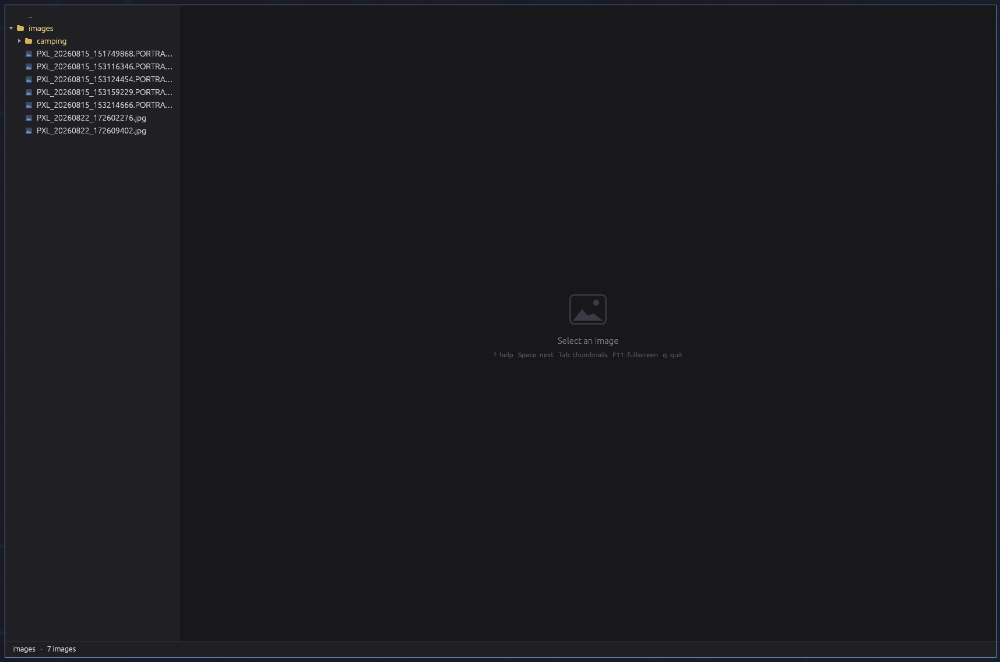

# vu

A minimalist image viewer for Linux, written in Rust. Open, browse, look. Nothing else.

`vu` cannot edit, delete or rename anything. It does one thing and aims to do it fast: the interface should never freeze, even in a folder of thousands of 20 MB photos.



## Highlights

- **Fast by construction.** No decoding, no folder reading and no image downscaling ever happens on the UI thread. A pool of workers serves requests from a priority queue.
- **Smooth browsing.** Neighbouring images (n±1, then n±2) are preloaded. When the selection moves quickly, stale requests are dropped before or after decoding, without ever creating a useless texture.
- **Shared thumbnails.** The disk cache follows the [freedesktop specification](https://specifications.freedesktop.org/thumbnail-spec/latest/) (`~/.cache/thumbnails/large/`). A thumbnail already generated by another program is reused, and the ones `vu` writes are reused by other programs.
- **Reduced JPEG decoding.** JPEG thumbnails go through `libjpeg-turbo` (DCT-scaled decoding): about 5 times faster than decoding the whole image and then downscaling it (see [Performance](#performance)).
- **Fluid zoom.** Wheel zoom centred on the cursor, mouse panning, pixel-exact actual size (HiDPI included).
- **Sharp SVG at any zoom.** SVGs are rasterised at display size and re-rasterised once the zoom settles.
- **Native Wayland**, with an `app_id` (`vu`) for compositor window rules.

## Installation

### Requirements

- A recent Rust toolchain (2024 edition).
- `libjpeg-turbo` with `libturbojpeg` and its headers, plus `pkg-config`.
- A **Wayland** session. `vu` is not built with X11 support.

Usual packages for `libturbojpeg`:

| Distribution | Package |
|---|---|
| Debian, Ubuntu | `libturbojpeg0-dev` |
| Fedora | `turbojpeg-devel` |
| Arch | `libjpeg-turbo` |
| Void | `libjpeg-turbo-devel` |

### Building

```sh
git clone <repository-url> vu
cd vu
cargo install --path .
```

Always use the *release* profile (it is the one `cargo install` uses) to judge smoothness: in a *debug* build, image downscaling is much slower.

## Usage

```sh
vu                  # open the current folder
vu ~/Pictures       # open this folder
vu photo.jpg        # open the parent folder and select photo.jpg
```

The window appears before anything is decoded.

### Formats

JPEG, PNG, WebP, GIF (first frame only), BMP, TIFF and SVG. EXIF orientation is applied. Transparency is shown over the neutral background, without a checkerboard.

### The left panel

Two modes, switched with `Tab`.

- **Tree** (default): the root is the folder you opened. Only folders and supported images are shown, folders first, then case-insensitive natural order (`img2` before `img10`). A folder's contents are only read when you expand it.
- **Thumbnails**: a grid of the current folder's images. The number of columns follows the panel width, and only the visible thumbnails (plus a margin) are requested.

### Keyboard shortcuts

| Key | Action |
|---|---|
| `↑` `↓` | Previous / next item (tree or grid) |
| `←` `→` | Tree: collapse / expand. Grid: previous / next thumbnail |
| `Enter` | Expand / collapse a folder |
| `Space`, `Shift+Space` | Next / previous image in the folder, in either mode |
| `Tab` | Switch tree ↔ thumbnails |
| `Backspace`, or click on `..` | Re-root the tree on the parent folder |
| `.` | Show / hide hidden files |
| `f` | Fit to window |
| `1` | Actual size (100 %) |
| `+` `-` | Zoom in / out |
| `F11` | Fullscreen (hides the panel and the status bar) |
| `F5` | Re-read the current folder |
| `?` | Show / hide the help window |
| `q` | Quit |
| `Esc` | Close the help window, leave fullscreen, or quit |

With the mouse: the wheel zooms around the cursor, dragging pans the image, and a double-click toggles between fit and 100 %.

## Performance

Measured on a synthetic 20 Mpx JPEG (5472 × 3648), release profile, a single core:

| Path | Time per thumbnail |
|---|---|
| Full decode, then downscale | ~180 ms |
| `libjpeg-turbo` (DCT-scaled decode) | ~33 ms |

The image is smoother than a real photo, so real-world times will be somewhat higher, but the ratio between the two paths should stay in the same range. A thumbnail already in the cache is read back in under a millisecond.

To repeat the measurement on your machine:

```sh
VU_BENCH_DIR=/tmp cargo test --release bench_jpeg -- --ignored --nocapture
```

## Architecture

```
src/
  main.rs     command line, window setup
  app.rs      application state, egui loop, panels and keyboard
  tree.rs     lazy tree and natural sort order
  thumbs.rs   grid, freedesktop disk cache (256 px PNG, MD5 key of the URI)
  loader.rs   workers, priority queue, generations, LRU caches
  viewer.rs   zoom and pan (pure, tested functions)
  formats.rs  detection by extension, raster decoding, turbo JPEG, SVG
```

The flow between the UI and the loader:

1. A selection change bumps the **generation** and issues requests for the current image and its neighbours.
2. Workers pop by priority: current image, neighbours, visible thumbnails, margin.
3. A result whose image is no longer wanted is discarded. Otherwise it is sent back over a channel, followed by `ctx.request_repaint()`.
4. The UI creates the texture and inserts it into an LRU cache: about 5 full-size textures, and a 192 MB budget for thumbnails.

Stack: [`eframe`/`egui`](https://github.com/emilk/egui), [`image`](https://crates.io/crates/image), [`fast_image_resize`](https://crates.io/crates/fast_image_resize), [`resvg`](https://crates.io/crates/resvg), [`turbojpeg`](https://crates.io/crates/turbojpeg), [`png`](https://crates.io/crates/png).

## Development

```sh
cargo run --release -- <folder>
cargo test
cargo clippy --all-targets
```

## Out of scope

Deliberately absent: editing, deleting, renaming, slideshow, EXIF panel, configuration file, file system watching.

## Known limitations

- Wayland only.
- SVGs that reference external images are not guaranteed to render.
- No configuration file: settings live in the code.

## License

Distributed under the [Apache-2.0](LICENSE) license.

## Disclaimer

This project was written with [Claude Code](https://claude.com/claude-code), Anthropic's coding assistant, from a specification written by the author. The code is tested (unit tests, `clippy` with no warnings) but is provided as is, without warranty: review it before relying on it.
